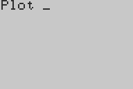

# casio-doom

Can a 1985 Casio graphing calculator run Doom? No. Can it draw something that
looks like Doom from across the room? Yes.


That's a stored program running at the calculator's real speed: an enemy
walks towards you over four frames, then you fire. Each frame is a full clear
and redraw, so it runs at about half a frame per second.

This repository has:

- **`examples/doom.fx`**, the program: a 367-byte listing you can type into a
  real fx-7000G or FX-8000G.
- **`fxrun`**, a command-line, scriptable build of Piotr Piatek's
  [Casio FX-8000G emulator](https://pisi.com.pl/piotr433/fx8000ee.htm). It
  needs no window, Wine or virtual display. It runs the real ROM in emulated
  time, much faster than real time, and saves screenshots or animation frames.
- **`examples/doom-prog.txt`**, a key script that types the program into
  Prog 0 in WRT mode, checks the memory used, and runs it.
- **`examples/doom.txt`**, the earlier version: the same scene typed as
  direct commands at the RUN prompt, without storing a program.
  
- **`examples/pong.fx`**, a playable, turn-based Pong (see below), and
  **`examples/pong-play.txt`**, which types it in and plays a demo game.

## Pong


The calculator can't read a key while a program is running, so real-time
Pong is impossible. This version is turn-based and suits the hardware:

1. The computer serves from the right at a random height and angle. The ball
   bounces off the top and bottom walls and leaves a trail.
2. At the halfway line the game stops with a flashing pointer on your side.
   Move it up or down with the arrow keys to where you think the ball will
   arrive, then press `EXE`. The ruler on the left edge has a tick every 10
   pixels.
3. The ball finishes its path. If your paddle is within 5 pixels, you score
   and the next serve starts. A miss ends the game and shows your score.

It's 264 bytes on the emulator, so it should fit on an fx-7000G. Type it into
any program area the same way as DOOM (below); the demo script uses Prog 1.

Two tricks make it work in so little memory:

- **Input:** `Plot x,y◢` stops with a pointer you can move, and `Plot` leaves
  the pointer's position in X and Y. So the paddle is just `Y→H`.
- **Bouncing without branches:** the ball's height is kept "unfolded", as if
  there were no walls, and `61-Abs (60-120Frac (V÷120))` folds it back between
  the walls each step.

The demo game scores 3: it plays the first three serves (one of them 2
pixels off, still inside the paddle) and misses the fourth on purpose. The
emulator is deterministic, so `Ran#` gives the same serves on every run.

The flashes of "done" on the text screen, and the brief gaps in the trail
after each pause, are the calculator's own behaviour: `◢` prints "done", and
the graph screen is redrawn after it.

The FX-8000G is the fx-7000G's sibling: same 96×64 screen, keyboard and
programming language, but with more program memory. Anything drawn here works
the same way on an fx-7000G, as long as it fits in that model's 422 steps.

## Build and run

Needs Free Pascal 3.2 (`apt-get install fp-compiler`), plus `curl` and
`unzip`. Optionally ImageMagick, to turn screenshots into PNGs and GIFs.

```bash
./build.sh
```

```bash
./build/fxrun examples/doom-prog.txt
```

```bash
convert out/doom-prog.pgm out/doom-prog.png
```

`build.sh` runs `fetch.sh` the first time. That downloads the emulator's
Lazarus port (version 13) from Piotr Piatek's site and copies its core units
into `src/` and its ROM images into `rom/`. Neither is stored in this
repository: the core is Piotr Piatek's code and the ROMs are Casio's firmware.

To turn the recorded frames into an animation:

```bash
convert -delay 10 -loop 0 out/prog-frames/frame*.pgm -resize 50% -colors 2 -layers Optimize out/doom-program.gif
```

## Typing the program into a real calculator

1. Press `MODE` `2` for WRT mode, then `EXE` to open Prog 0.
2. Type each line of `examples/doom.fx`, pressing `EXE` at the end of each
   one. Skip the `#` comment lines.
   - `->` (or `→`) is the → key, `=>` (or `⇒`) is SHIFT 7, `/` (or `÷`)
     is the ÷ key, `◢` is SHIFT `:`, and `?` is SHIFT →.
   - `Range` is the RANGE key. `Plot`, `Line`, `Cls`, `Lbl` and `Goto` are
     SHIFT functions (see the key map below).
3. Press `MODE` `1` for RUN mode, then type `Prog 0` and press `EXE`.

On the emulator, the program takes 367 bytes (1446 free before, 1079 after).
That should fit in the fx-7000G's 422 steps, since each command and character
takes one step on that model, but I haven't tested it on real hardware.

## How it works

The emulator separates its CPU, display and keyboard code from its window,
so `fxrun` uses these units unchanged:
`def cpu decode exec lcd keyboard fa80`.

The repository's own code is:

- `src/fxrun.pas`: the driver. Its main loop is copied from `OnRunTimer` in
  the emulator's `main.pas`, without the debugger hooks.
- `src/comm.pas`: a stub that replaces the window-based cassette and printer
  unit. No tape or printer is attached.

## Script commands

Usage: `fxrun [-d romdir] [-s] script.txt` (use `-` to read the script from
stdin). `-s` saves the RAM back to `romdir` on exit, as the GUI does. Lines
starting with `#` are comments.

| Command | Meaning |
|---|---|
| `wait MS` | run for MS milliseconds of calculator time |
| `press KEY ...` | press keys in turn; `KEY*N` repeats a key |
| `type TEXT` | type text: program keywords (`Plot`, `Line`, `Range`, `Cls`, `Lbl`, `Goto`, `Isz`, `Dsz`, `Graph Y=`, `Abs`, `Int`, `Frac`, `Ran#`, `->` or `→`, `=>` or `⇒`, `◢`, `?`, `<` `>` `<=` `>=` `<>`, `(-)` …), digits, operators (`/` or `÷`), `,` `:` and letters (via ALPHA) |
| `program FILE` | type a program listing, pressing `EXE` after each line (open a program area in WRT mode first) |
| `shot FILE.pgm` | save the 96×64 display |
| `ascii` | print the display as text |
| `record DIR [MS]` / `record off` | save a frame every MS ms (default 100) |
| `scale N` | screenshot pixel size (default 4) |
| `hold MS` / `gap MS` | key-down time and gap after release (default 60 each) |
| `init` | memory-initialisation button |

Key names: `SHIFT ALPHA PROG LEFT RIGHT UP DOWN MODE MDISP GRAPH RANGE GT : ENG
SQRT X2 LOG LN RECIP DMS HYP SIN COS TAN NEG STO ( ) POW XROOT 0-9 DEL AC * / +
- . EXP ANS EXE OFF INIT HD`.

SHIFT functions, which press SHIFT for you: `PLOT LINE CLS ABS COMMA THEN GOTO
LBL ISZ DSZ FACTOR INT FRAC PI RAN# MCL ? DISP = <> >= <= > < PRINT ASIN ACOS
ATAN`. The map came from pressing SHIFT with every key:
[media/shift-sheet.png](media/shift-sheet.png).

## Tips for drawing on the calculator

- The graph area is 95×63 pixels, so `Range 0,94,0,0,62,0` makes one unit
  exactly one pixel. The axes then sit on the bottom and left edges; give
  them a scale (like `Yscl 10`) and they become rulers. DOOM uses
  `1,96,0,1,64,0`, which is close to one pixel and pushes the axes off-screen.
- Enter negative Range values with the (-) key (`NEG`), not minus.
- Six `EXE`s on the Range screen leave it. Pressing `RANGE` again reopens it,
  and `AC` doesn't close it.
- `Line` joins the last two plotted points, so `Plot A:Plot B:Line:Plot C:Line`
  draws two connected lines.
- A statement line that ends in `Plot` leaves the flashing pointer and an
  `X=` readout over the bottom of the screen. End it with `Line` instead.
- Graphs draw at real-calculator speed: `Graph Y=.67Abs X` takes about 3
  seconds of calculator time.
- Don't keep your own values in X or Y: `Plot` stores its coordinates there.
- There's no command to erase a point or a line, so animation means `Cls`
  and redrawing the whole frame. Line art merges where shapes overlap, so keep
  moving things apart (that's why the enemy walks off to the left).
- For input there's `?`, which stops and asks for a number on the text screen
  (you can't flip to the graph while it waits), and `Plot x,y◢`, which stops
  on the graph with a pointer you move with the arrow keys. There's no way to
  read a key while a program keeps running.
- `◢` ends a statement, like `:`, and needs something before it.
  `Plot 3,31◢Y→H` works; a `◢` alone on a line is a syntax error.

## Credits

The emulator is by Piotr Piatek: https://pisi.com.pl/piotr433/
