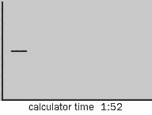
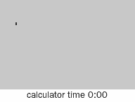
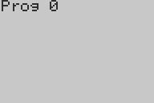
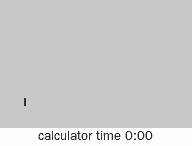

# casio-doom

Can a 1985 Casio graphing calculator run Doom? No. Can it draw something that
looks like Doom from across the room? Yes.


That's a stored program running at the calculator's real speed: an enemy
walks towards you over four frames, then you fire. Each frame is a full clear
and redraw, so it runs at about half a frame per second.

This repository has:

- **`examples/doom.fx`**, the program: a 367-byte listing you can type into a
  real fx-7000G or FX-8000G.
- **`fxrun`**, a command-line, scriptable build of Piotr Piatek's
  [Casio FX-8000G emulator](https://pisi.com.pl/piotr433/fx8000ee.htm). It
  needs no window, Wine or virtual display. It runs the real ROM in emulated
  time, much faster than real time, and saves screenshots or animation frames.
- **`examples/doom-prog.txt`**, a key script that types the program into
  Prog 0 in WRT mode, checks the memory used, and runs it.
- **`examples/doom.txt`**, the earlier version: the same scene typed as
  direct commands at the RUN prompt, without storing a program.
  
- **`examples/pong.fx`**, a playable, turn-based Pong (see below), and
  **`examples/pong-play.txt`**, which types it in and plays a demo game.
- **`examples/mandel.fx`**, the world's slowest Mandelbrot generator (see
  below), and **`examples/mandel-run.txt`**, which runs it.
- **`examples/frak/`**, a mock-up of the Frak! level 1 front screen (see
  below).
- **`examples/bits/`**, a renderer that draws numbers as columns of binary
  dots, used to draw the real Trogg and Scrubbly sprites (see below).
- **`examples/frak7000/`**, the Frak! screen again, redone with the renderer
  and squeezed into the fx-7000G's memory (see below).
- **`examples/linux/`**, "Linux" for the fx-7000G: a Tux splash, a boot log
  and a login that says PERMISSION DENIED to everyone (see below).

## Pong


The calculator can't read a key while a program is running, so real-time
Pong is impossible. This version is turn-based and suits the hardware:

1. The computer serves from the right at a random height and angle. The ball
   bounces off the top and bottom walls and leaves a trail.
2. At the halfway line the game stops with a flashing pointer on your side.
   Move it up or down with the arrow keys to where you think the ball will
   arrive, then press `EXE`. The ruler on the left edge has a tick every 10
   pixels.
3. The ball finishes its path. If your paddle is within 5 pixels, you score
   and the next serve starts. A miss ends the game and shows your score.

It's 264 bytes on the emulator, so it should fit on an fx-7000G. Type it into
any program area the same way as DOOM (below); the demo script uses Prog 1.

Two tricks make it work in so little memory:

- **Input:** `Plot x,y◢` stops with a pointer you can move, and `Plot` leaves
  the pointer's position in X and Y. So the paddle is just `Y→H`.
- **Bouncing without branches:** the ball's height is kept "unfolded", as if
  there were no walls, and `61-Abs (60-120Frac (V÷120))` folds it back between
  the walls each step.

The demo game scores 3: it plays the first three serves (one of them 2
pixels off, still inside the paddle) and misses the fourth on purpose. The
emulator is deterministic, so `Ran#` gives the same serves on every run.

The flashes of "done" on the text screen, and the brief gaps in the trail
after each pause, are the calculator's own behaviour: `◢` prints "done", and
the graph screen is redrawn after it.

## The world's slowest Mandelbrot generator



`examples/mandel.fx` (164 bytes) tests every pixel by iterating z → z² + c up
to 15 times. The set is symmetric, so it only calculates the top half and
plots each point twice. Even so, it takes **32 minutes 56 seconds** of
calculator time. The emulator does it in about 7 seconds.

`examples/mandel-run.txt` types it into Prog 2, runs it and records a frame
every 2 seconds of calculator time. The time-lapse above uses the frames that
caught the graph screen.

While it runs, a real calculator mostly shows its text screen: it switches to
text whenever a statement that isn't a graph command runs, and only shows
the graph again after a graph command. So the program plots a dot on the
bottom axis after each column to flash the picture up, and ends with
`Graph Y=0` (which redraws only the bottom axis) so it finishes on the
picture. Then the calculator's auto power-off turns the display off 6
minutes later.

The FX-8000G is the fx-7000G's sibling: same 96×64 screen, keyboard and
programming language, but with more program memory. Anything drawn here works
the same way on an fx-7000G, as long as it fits in that model's 422 steps.

## Frak! front screen


A mock-up (not playable) of the first screen of Frak! level 1: the Trogg in
outline at the bottom left, three Scrubblies, the ledges with their rock
baskets, and the ladders. Positions come from `room_A_1` in
[steamfrak](https://github.com/nickpellinguk/steamfrak), scaled down about
3 times; the sprites are hand-drawn outlines based on the BBC Micro ones.

It's four programs in `examples/frak/`:

| Program | File | Draws |
|---|---|---|
| Prog 0 | `screen.fx` | the screen, calling the others |
| Prog 1 | `ledge.fx` | a run of ledge segments (A, B = left end and top, N = segments) |
| Prog 2 | `ladder.fx` | a ladder (A, B = centre and top, L = length) |
| Prog 3 | `scrubbly.fx` | a Scrubbly (A, B = feet) |

```bash
./build/fxrun examples/frak/run.txt
```

It draws in about 23 seconds of calculator time and uses 1178 bytes, so it
needs the FX-8000G's memory: it won't fit in an fx-7000G's 422 steps.

`examples/frak/generate.py` rebuilds the listings from the room data. It
expects a steamfrak checkout next to this repository, or its path as an
argument.

Approximations: the view is the left 290 pixels of the room. The ladder behind
the Trogg stops above his head, because overlapping outlines merge into a
blob at this size, and gems and keys are left out.

## Frak! front screen, compact version



The same screen, aimed at the fx-7000G's 422 steps and looking more like the
game. Everything is drawn by the binary column renderer as pixel art:

- **Sprites:** a 9×9 Scrubbly and a 9×9 Trogg, three 9-row columns per
  number. They're 9 rows tall like the ladder segment, so they reuse its
  width and height settings, and the Trogg fits in three numbers. The
  Scrubbly is left-right symmetric, so only its left half and centre column
  are stored (two numbers), and the renderer mirrors them:
  it also plots each dot at column E−A, where E is twice the mirror axis. For
  everything else E is 0 or negative, so the mirror image lands off-screen,
  which the calculator silently ignores.
- **Ledges:** one 5×4 segment (a strip with a rock basket), number 219475,
  repeated to the right.
- **Ladders:** one 3×9 segment, a pole with three rungs (number
  19398217), like the BBC ladder sprite. Each ladder is one segment, or two
  for the long one, overlapping the ledges where it needs to. (A 5-wide
  segment three rungs tall would be 45 binary digits, too many for one
  number.)

It's five programs in `examples/frak7000/`, plus a little setup, all made by
`generate.py`:

| Program | File | Bytes | Does |
|---|---|---|---|
| Prog 0 | `screen.fx` | 250 | places everything |
| Prog 1 | `repeat.fx` | 40 | draws a bitmap N times in a row or column |
| Prog 2 | `pair.fx` | 16 | draws Prog 1 twice, S columns apart |
| Prog 3 | `scrubbly.fx` | 22 | a Scrubbly: two numbers, mirrored, placed by its mirror axis |
| Prog 4 | `render.fx` | 75 | the renderer, with mirroring |

**Setup, by hand in RUN mode, before running Prog 0:**

1. Set the Range to `1, 95, 0, 1, 63, 0` on the Range screen. That also
   clears the graph.
2. Store the sprite and segment numbers in letters (`setup.fx`):

   ```
   219475→I
   19398217→L
   126371864→T
   52308745→R
   656699→G
   90786392→M
   34266→Z
   ```

The 26 letter variables are separate from program memory, so these cost no
program steps, and the programs use one letter for each number instead of up
to 9 digits. Both settings survive between runs; running Prog 0 again just
redraws the same picture over itself.

```bash
./build/fxrun examples/frak7000/run.txt
```

**Size:** 397 bytes on the calculator, which **fits the fx-7000G's 422 steps**
with 25 to spare. (`bytes.py` gives the per-file counts; its total is a few
bytes higher.) It started at 1178 for the outline version; moving the setup
out of Prog 0 took it from 455 to 397. It draws in about a minute and a half
of calculator time. It's only been run on the emulated FX-8000G, not on a
real fx-7000G.

Two limits shaped it:

- **10 typed digits:** the calculator works with about 13 digits (halving is
  exact up to 39 binary digits), but only 10 can be typed into a number. So
  each number holds at most 33 binary digits: three 11-row columns.
- **Byte cost:** every digit and command costs a byte, so values shared by
  several objects (a row, a length) are set once. The five blocks of the
  staircase step evenly (20 room pixels right and 7 down), so Prog 1 draws
  them in one call, with its steps E and F set to the staircase's slope.
  The middle-left platform is 6 blocks wide like the top two (it's 5 in
  the original), so all three share one length.
- **Top to bottom:** this renderer draws each column from the top row down
  (lowest binary digit at the top), which made the 11-row Trogg's numbers
  4 digits shorter, because his empty space was at the top right.
- **Pairs:** many objects come in pairs 42 columns apart (the platforms,
  ladders and bottom ledges on the left and right halves of the screen), so
  Prog 2 draws one at A and another at A+S, with S=42. A few objects moved
  a pixel to line up, and the long ladder became two single segments so its
  top half pairs with the left ladder. The lower right-hand ladders are a
  pair 25 apart, so they're drawn last with S=25. (A fixed +25 Prog 2 for
  the right-hand pairs alone was 11 bytes worse.)
- **Placing by E:** a Scrubbly is placed by its mirror axis E rather than
  its left column. The renderer moves A on, but leaves E alone, so the two
  Scrubblies in the same column only need a new top row.
- **Simplified:** the 2-block platform at the bottom right is a single
  ledge, under the short ladder. It has no partner 42 columns away, so it
  costs its own call (8 bytes).
- **Magic numbers last:** no number has a shorter form (powers, squares,
  EXP notation): they're effectively random bit patterns. The final pass
  found other small savings instead:
  - `Range` clears the graph screen, so `Cls` isn't needed.
  - The Scrubbly's second number held column 5, which the mirror draws
    anyway; with it zeroed the number is 5 digits, not 9.
  - Staircase steps of 1 and −2 instead of 1.4 and −2.1.
  - The bottom ledges are 3 rows higher, so the Trogg's top row is 17, where
    the ladders leave C. The lower ladders now reach their ledges, and the
    ladder above the Trogg comes down to his head, as in the original.
  - Tried and rejected: `Mcl` doesn't clear variables inside a program;
    `Range` with five values draws an axis; a condition needs a comparison
    (`Frac D⇒` is a syntax error).

## Linux on the fx-7000G



A friend's challenge: run Linux on the fx-7000G. `examples/linux/` fakes it in
349 bytes, well inside the 422 steps:

1. **Splash:** a 13×16 Tux, drawn by the binary column renderer. He's
   symmetric, so only half of him is stored, as four numbers. He stays up
   for about 4½ seconds: four `Graph Y=0` commands, which draw nothing
   (y=0 is off-screen) but take about 1.1 s each and keep the graph screen
   showing. A counting loop would switch to the text screen.
2. **Boot log:** kernel-style timestamps, the real CPU (NEC μPD1007 at
   910 kHz) and the memory (422 steps). All capitals, because that's all you
   can type into a string, like an early Unix terminal; 16 characters a line.
   It stays up for about 3 seconds (a count-down loop), then an empty line.
3. **Login:** `FX7000G LOGIN`, then `?`. It only takes numbers, and refuses
   every one with `PERMISSION DENIED` (on two lines: the phrase is 17
   characters, one more than a line holds), forever.

```bash
./build/fxrun examples/linux/run.txt
```

| Program | File | Bytes |
|---|---|---|
| Prog 0 | `linux.fx` | 274 |
| Prog 1 | `render.fx` | 75 |

`generate.py` makes `linux.fx` from the Tux pixel art.

## Binary column renderer



`examples/bits/render.fx` (Prog 4) takes a number and draws its binary digits
as a column of dots, lowest digit at the bottom: a 1 is a dot, a 0 is a gap.
Then it moves on to the next column, so a picture is just a list of numbers.

- **Inputs:** N is the number, A the column, and C the bottom row. If M
  isn't 0, its digits carry on above N's from row C+H, for columns taller
  than one number holds.
- **Precision:** halving stays exact up to about 34 binary digits on this
  calculator (it fails by 44), so the sprites use 21 digits per number.

Two programs use it:

- **`sprites.fx`** (Prog 0) draws the Trogg and a Scrubbly at their full BBC
  Micro size from the black pixels of the real sprites: 59 columns, one or
  two numbers each (`1060608→N:7→M:Prog 4`). `generate.py` makes it from the
  sprites in steamfrak. It takes about 2 minutes of calculator time.
- **`input.fx`** (Prog 5) asks for numbers with `?`, draws each one as the
  next column, and shows the picture (press EXE for the next number).
  Typing 1023, 1023, 816, 816, 816, 816, 768, 768, … gives:

  

```bash
./build/fxrun examples/bits/run.txt
```

The run script types all three programs in, draws the sprites, then types
"FRAK!" into Prog 5. Together the three programs use 1249 bytes.

## Build and run

Needs Free Pascal 3.2 (`apt-get install fp-compiler`), plus `curl` and
`unzip`. Optionally ImageMagick, to turn screenshots into PNGs and GIFs.

```bash
./build.sh
```

```bash
./build/fxrun examples/doom-prog.txt
```

```bash
convert out/doom-prog.pgm out/doom-prog.png
```

`build.sh` runs `fetch.sh` the first time. That downloads the emulator's
Lazarus port (version 13) from Piotr Piatek's site and copies its core units
into `src/` and its ROM images into `rom/`. Neither is stored in this
repository: the core is Piotr Piatek's code and the ROMs are Casio's firmware.

To turn the recorded frames into an animation:

```bash
convert -delay 10 -loop 0 out/prog-frames/frame*.pgm -resize 50% -colors 2 -layers Optimize out/doom-program.gif
```

## Typing the program into a real calculator

1. Press `MODE` `2` for WRT mode, then `EXE` to open Prog 0.
2. Type each line of `examples/doom.fx`, pressing `EXE` at the end of each
   one. Skip the `#` comment lines.
   - `->` (or `→`) is the → key, `=>` (or `⇒`) is SHIFT 7, `/` (or `÷`)
     is the ÷ key, `◢` is SHIFT `:`, and `?` is SHIFT →.
   - `Range` is the RANGE key. `Plot`, `Line`, `Cls`, `Lbl` and `Goto` are
     SHIFT functions (see the key map below).
3. Press `MODE` `1` for RUN mode, then type `Prog 0` and press `EXE`.

On the emulator, the program takes 367 bytes (1446 free before, 1079 after).
That should fit in the fx-7000G's 422 steps, since each command and character
takes one step on that model, but I haven't tested it on real hardware.

## How it works

The emulator separates its CPU, display and keyboard code from its window,
so `fxrun` uses these units unchanged:
`def cpu decode exec lcd keyboard fa80`.

The repository's own code is:

- `src/fxrun.pas`: the driver. Its main loop is copied from `OnRunTimer` in
  the emulator's `main.pas`, without the debugger hooks.
- `src/comm.pas`: a stub that replaces the window-based cassette and printer
  unit. No tape or printer is attached.

## Script commands

Usage: `fxrun [-d romdir] [-s] script.txt` (use `-` to read the script from
stdin). `-s` saves the RAM back to `romdir` on exit, as the GUI does. Lines
starting with `#` are comments.

| Command | Meaning |
|---|---|
| `wait MS` | run for MS milliseconds of calculator time |
| `press KEY ...` | press keys in turn; `KEY*N` repeats a key |
| `type TEXT` | type text: program keywords (`Plot`, `Line`, `Range`, `Cls`, `Lbl`, `Goto`, `Isz`, `Dsz`, `Graph Y=`, `Abs`, `Int`, `Frac`, `Ran#`, `->` or `→`, `=>` or `⇒`, `◢`, `?`, `²`, `=` `<` `>` `<=` `>=` `<>` or `≠`, `(-)` …), digits, operators (`/` or `÷`), `,` `:` and letters (via ALPHA) |
| `program FILE` | type a program listing, pressing `EXE` after each line (open a program area in WRT mode first) |
| `shot FILE.pgm` | save the 96×64 display |
| `ascii` | print the display as text |
| `record DIR [MS]` / `record off` | save a frame every MS ms (default 100) |
| `scale N` | screenshot pixel size (default 4) |
| `hold MS` / `gap MS` | key-down time and gap after release (default 60 each) |
| `init` | memory-initialisation button |

Key names: `SHIFT ALPHA PROG LEFT RIGHT UP DOWN MODE MDISP GRAPH RANGE GT : ENG
SQRT X2 LOG LN RECIP DMS HYP SIN COS TAN NEG STO ( ) POW XROOT 0-9 DEL AC * / +
- . EXP ANS EXE OFF INIT HD`.

SHIFT functions, which press SHIFT for you: `PLOT LINE CLS ABS COMMA THEN GOTO
LBL ISZ DSZ FACTOR INT FRAC PI RAN# MCL ? DISP = <> >= <= > < PRINT ASIN ACOS
ATAN`. The map came from pressing SHIFT with every key:
[media/shift-sheet.png](media/shift-sheet.png).

## Tips for drawing on the calculator

- The graph area is 95×63 pixels, so `Range 0,94,0,0,62,0` makes one unit
  exactly one pixel. The axes then sit on the bottom and left edges; give
  them a scale (like `Yscl 10`) and they become rulers. DOOM uses
  `1,96,0,1,64,0`, which is close to one pixel and pushes the axes off-screen.
- Enter negative Range values with the (-) key (`NEG`), not minus.
- Six `EXE`s on the Range screen leave it. Pressing `RANGE` again reopens it,
  and `AC` doesn't close it.
- `Line` joins the last two plotted points, so `Plot A:Plot B:Line:Plot C:Line`
  draws two connected lines.
- A statement line that ends in `Plot` leaves the flashing pointer and an
  `X=` readout over the bottom of the screen. End it with `Line` instead.
- Graphs draw at real-calculator speed: `Graph Y=.67Abs X` takes about 3
  seconds of calculator time.
- Don't keep your own values in X or Y: `Plot` stores its coordinates there.
- There's no command to erase a point or a line, so animation means `Cls`
  and redrawing the whole frame. Line art merges where shapes overlap, so keep
  moving things apart (that's why the enemy walks off to the left).
- For input there's `?`, which stops and asks for a number on the text screen
  (you can't flip to the graph while it waits), and `Plot x,y◢`, which stops
  on the graph with a pointer you move with the arrow keys. There's no way to
  read a key while a program keeps running.
- Programs can call each other as subroutines (`Prog 1`), sharing the
  variables A–Z; the called program returns when it ends.
- In WRT mode, the program-slot cursor stays on the last slot used and wraps
  from 9 to 0, so moving to a slot means counting from where it is.
- `◢` ends a statement, like `:`, and needs something before it and after
  it on the same line. `Plot 3,31◢Y→H` works; a `◢` alone on a line, or at
  the end of one, is a syntax error.
- `Graph Y=0◢` (with y=0 off-screen) is a handy way to show the graph screen
  and wait for EXE without drawing anything.

## Credits

The emulator is by Piotr Piatek: https://pisi.com.pl/piotr433/
